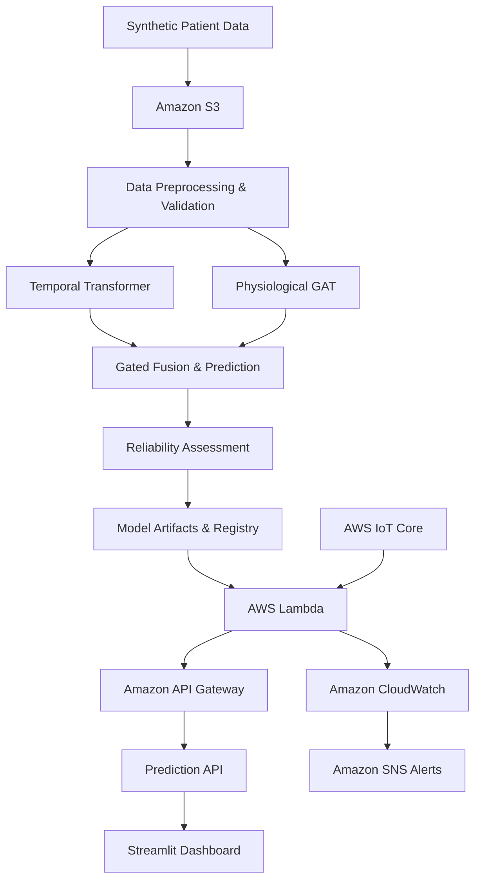

# Metacognitive Multimodal Temporal Learning for Early Prediction of Acute Respiratory Failure in TBI

A research and MLOps prototype for early prediction of Acute Respiratory Failure (ARF) in Traumatic Brain Injury (TBI) patients using temporal machine learning, physiological feature relationships, and model reliability assessment.

**Dataset:** Synthetic ICU data  
**Purpose:** Academic research and MLOps demonstration only. Not a clinically validated diagnostic tool.

## System Architecture

## Technologies Used

- **Machine Learning:** Python, Scikit-learn, PyTorch
- **Backend:** FastAPI, AWS Lambda, API Gateway
- **Cloud Storage:** Amazon S3
- **Monitoring:** Amazon CloudWatch, Amazon SNS
- **IoT Integration:** AWS IoT Core
- **Dashboard:** Streamlit
- **Experiment Tracking:** MLflow

## Key Features

- Temporal patient observation modelling.
- Transformer and physiological GAT-based research architecture.
- Prediction reliability, uncertainty, and OOD assessment.
- Model evaluation, versioning, and experiment tracking.
- AWS-based inference and monitoring demonstration.

