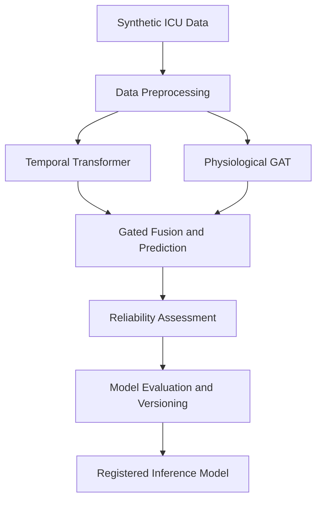
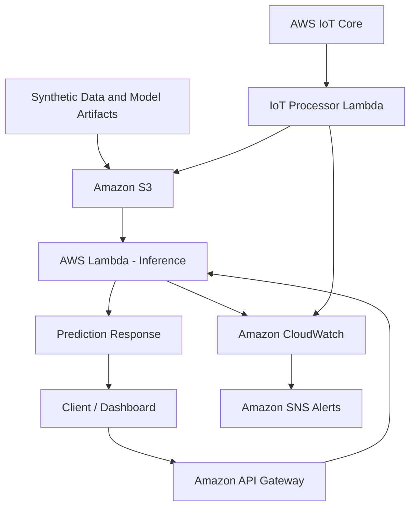

# Metacognitive Multimodal Temporal Learning for Early Prediction of Acute Respiratory Failure in TBI

## 1. Project Overview

This project presents a multimodal temporal machine learning and MLOps prototype for early prediction of Acute Respiratory Failure (ARF) in patients with Traumatic Brain Injury (TBI).

The research architecture combines a Transformer for learning temporal patterns with a Physiological Graph Attention Network (GAT) for modelling relationships between clinical features. A reliability assessment layer incorporates uncertainty estimation, out-of-distribution (OOD) detection, and prediction confidence.

The project uses synthetic ICU data for model development, evaluation, and cloud deployment demonstrations.

### Machine Learning Workflow

## 2. AWS Cloud Architecture and Workflow

This workflow demonstrates cloud storage, serverless inference, API access, IoT data processing, logging, and alert integration. The Transformer-GAT research model is developed separately from the registered CPU-based inference model used by the serving workflow.

## 3. AWS Services and Their Functions

| AWS Service | Purpose in the Project |
|---|---|
| **Amazon S3** | Stores synthetic data, model artifacts, and project files. |
| **AWS Lambda** | Runs serverless inference and IoT processing functions. |
| **Amazon API Gateway** | Provides an API endpoint to access prediction services. |
| **AWS IoT Core** | Supports ingestion of IoT messages and simulated patient data. |
| **Amazon CloudWatch** | Collects execution logs and monitoring information. |
| **Amazon SNS** | Supports notification and alert integration. |
| **Amazon ECR** | Stores container images for cloud deployment workflows. |
| **AWS Amplify** | Supports frontend hosting and dashboard deployment. |
| **AWS IAM** | Manages roles, permissions, and secure service access. |

